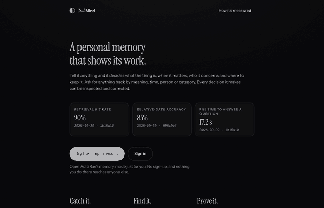
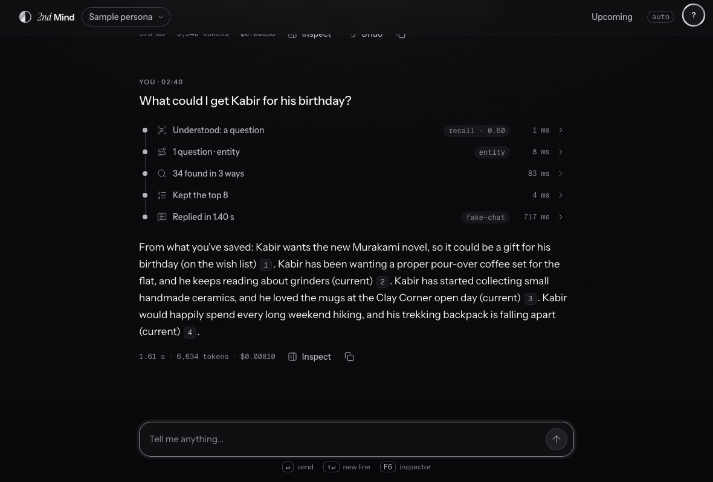
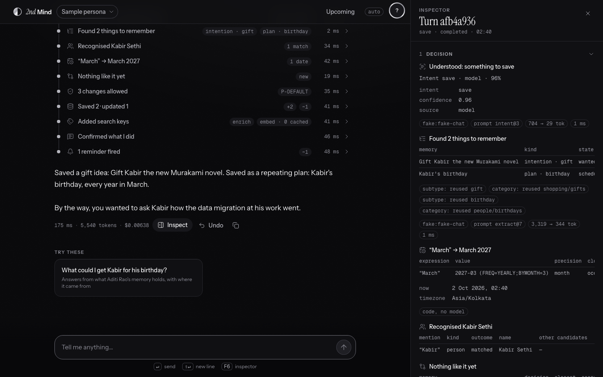
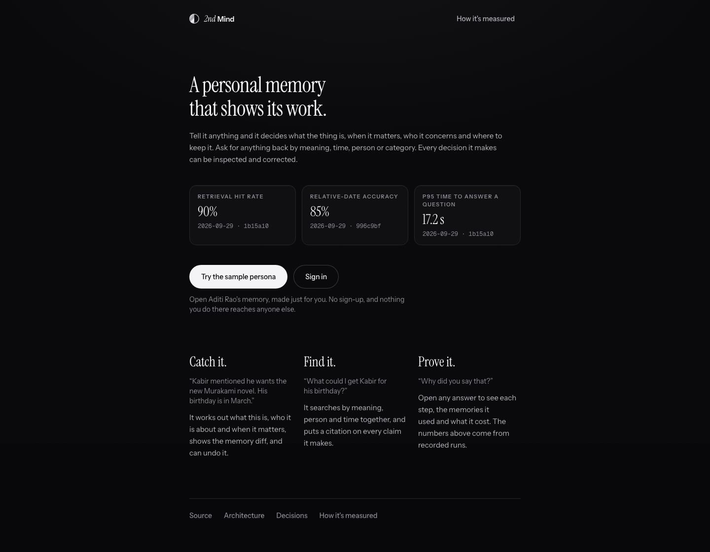
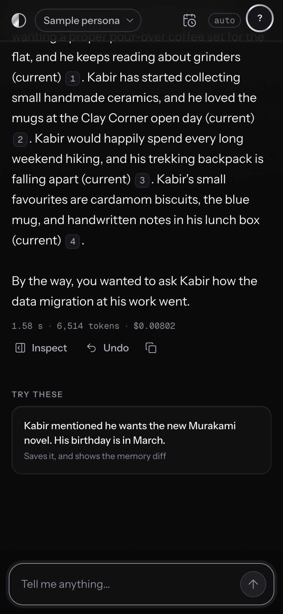

# 2nd Mind

**A personal memory that shows its work.**

[](https://github.com/RaajPatel132/2nd-Mind/actions/workflows/ci.yml)
[](LICENSE)
[](https://github.com/RaajPatel132/2nd-Mind/commits)

<p align="center">
  
</p>

*A first visit to the sample persona, recorded on the offline stack: the model's replies are
scripted there, and everything else (the pipeline, the storage, the screens) is the real thing.*

Tell it anything: a show to watch, a gift idea, a deadline, a link. It decides what the thing is,
when it matters, who it concerns and where to keep it. Ask for anything back by meaning, time,
person or category. Every step can be opened, and every decision can be corrected.

## Catch it. Find it. Prove it.

**Catch it.** *"Kabir mentioned he wants the new Murakami novel. His birthday is in March."* One
message becomes a gift idea linked to Kabir and a yearly plan for March, written through a policy
that can hold or refuse a change, with the memory diff shown and an Undo that replays the write
log backwards. Say "I moved to Pune" later and the old address is superseded, not overwritten:
the history stays answerable.

**Find it.** *"What could I get Kabir for his birthday?"* A planner picks the shape of the
question, code resolves the dates and people, structured tools and a semantic channel run side by
side, and the results are fused, reranked and answered with a citation on every claim. Ask it
something it was never told and it says so, without calling a model.

**Prove it.** Open any turn. The glass box shows what it decided, what it wrote, what it
retrieved and why, every tool call, and the time and dollars of each model call. The numbers
below are the same ones the site shows, and they come from recorded runs.

<table>
  <tr>
    <td width="50%"><br><sub>Find it: the Trail of steps, then an answer that cites its sources.</sub></td>
    <td width="50%"><br><sub>Catch it: the glass box on a save, with the memory diff.</sub></td>
  </tr>
  <tr>
    <td><br><sub>The front page, with its numbers and where they come from.</sub></td>
    <td><br><sub>The same product at 390 px; every screen works at 360.</sub></td>
  </tr>
</table>

## How well does it work

<!-- headline:start (generated by scripts/sync_readme_numbers.py; do not edit) -->
| Measure | Result | What it means | Run |
|---|---|---|---|
| Retrieval hit rate | **90%** | hit@5: the answer's source was in the top five for 37 of 41 questions with a known answer. Target 85%. | [`20260929T160542Z-1b15a10`](backend/evals/runs/recall/20260929T160542Z-1b15a10.json) |
| Relative-date accuracy | **85%** | 11 of 13 dates worked out from words like 'last night' or 'next May' were right. | [`20260929T122015Z-996c9bf`](backend/evals/runs/ingest/20260929T122015Z-996c9bf.json) |
| p95 time to answer a question | **17.2 s** | From sending a question to the end of the answer, over the recall set. Target 6 s; recall is being made faster. | [`20260929T160542Z-1b15a10`](backend/evals/runs/recall/20260929T160542Z-1b15a10.json) |

- `recall`: 45 of 51 cases passed on 2026-09-29, commit `1b15a10`, models `anthropic:claude-haiku-4-5`, `openai:gpt-5.4-mini`, `openai:gpt-6-luna`, `openai:text-embedding-3-small`
- `ingest`: 17 of 19 cases passed on 2026-09-29, commit `996c9bf`, models `anthropic:claude-haiku-4-5`, `openai:gpt-6-luna`, `openai:text-embedding-3-small`
<!-- headline:end -->

These are live runs against real models, stamped with the commit and the models and committed as
files. `make headline-check` fails if the site's numbers drift from them, and a test fails if this
table does. Where a number misses its target, it is shown with the target; the time to answer a
question is the open item. The evaluation sets are small and synthetic: they say how it did on
those cases, not on your data.

To read a run in full, `make eval-report A=<a run id from the table>` prints hit@5 and MRR for each
shape of question, the no-answer rate and the cost per case. `make eval-ingest` replays the
ingestion cases through the real code with no keys in a couple of seconds: that checks the code
around the model, not the model, which only a live run can.

## Why it is built this way

- **Reconcile, don't de-duplicate.** A new fact is compared with what is known and becomes new,
  more detail, a supersession, a fulfilment, a link or nothing. Changes keep their history and can
  be undone. [ADR-0019](docs/adr/0019-reconciliation.md)
- **Time is three clocks, and code does the arithmetic.** When it was said, when it happened and
  when it was true. "Last night" and "next May" are resolved by a deterministic grammar, never by
  the model. [ADR-0018](docs/adr/0018-memory-model.md), [ADR-0022](docs/adr/0022-time-resolution.md)
- **No filter is the only way in.** A semantic channel always runs beside the structured tools,
  so a mis-planned filter makes an answer worse instead of empty. [ADR-0026](docs/adr/0026-hybrid-search.md)
- **Isolation is proven, not promised.** Every owned table has row-level security, and tests try
  to cross the line through repositories and through raw SQL. [ADR-0003](docs/adr/0003-workspace-isolation-rls.md)
- **A pasted link is data, never an instruction.** One fetch door that pins the address it
  checked, and a model sees page text only inside a delimited block with a closed output schema.
  [ADR-0036](docs/adr/0036-link-fetching-and-fetch-safety.md), [ADR-0037](docs/adr/0037-content-is-data.md)
- **Spend can't run away.** Every call is priced in dollars; a gate before each turn checks a
  kill switch, caps and quotas, and fails closed. [ADR-0032](docs/adr/0032-spend-safety.md)
- **Models are configuration.** Each step names its provider and model; nothing else knows which
  served it, and an offline fake provider means the whole app runs with no keys.
  [ADR-0006](docs/adr/0006-provider-layer.md)
- **Prompts are released like code.** Versioned files, never edited after release.
  [ADR-0014](docs/adr/0014-prompt-registry.md)

The full picture, with diagrams, is in [`docs/architecture.md`](docs/architecture.md).

## Run it

Requirements: Docker (with Compose v2) and `make`. For development outside containers: `uv` and
Node 22+.

```bash
cp .env.example .env     # optional: add ANTHROPIC_API_KEY and/or OPENAI_API_KEY
make up                  # builds and starts everything, runs migrations, prints the URLs
make seed-persona        # loads the sample persona (a made-up designer in Bengaluru)
```

Open <http://localhost:8080> and choose **Try the sample persona**. With no provider keys the app
runs in **fake-provider mode** (deterministic, scripted replies), so everything works offline.
`make up-live` runs on real models when keys are set. `make down` stops the stack.

## Where things are

| | |
|---|---|
| [`backend/`](backend/) | Python 3.12, FastAPI, Postgres 16 with pgvector, Redis and arq, LangGraph. One module per domain under `src/secondmind/`, with the boundaries enforced in CI |
| [`frontend/`](frontend/) | React, TypeScript, Vite and Tailwind. The Ink design system, a generated API client, Playwright specs |
| [`docs/`](docs/README.md) | [Architecture](docs/architecture.md), the [product spec](docs/PRD.md), the [decision records](docs/adr/README.md), the [design system](docs/design/system.md), the [runbook](docs/runbook.md) |
| [`infra/`](infra/) | Terraform for the single production host |
| [`scripts/`](scripts/) | Operator and capture scripts |

## Develop

```bash
npm install              # git hooks and the commit standard
make install             # backend and frontend dependencies
make check               # everything CI runs, except the end-to-end suite
make help                # all targets
```

`make check` covers ruff, `mypy --strict`, the import contracts, an OpenAPI snapshot that the
generated client must match, over 700 unit and integration tests (the integration ones against
real Postgres and Redis in containers), the design-system check, gitleaks over the full history,
dependency audits and an image scan. The README's pictures are remade by
[`frontend/e2e/media.spec.ts`](frontend/e2e/media.spec.ts) and
[`scripts/make_demo_gif.py`](scripts/make_demo_gif.py).

See [`CONTRIBUTING.md`](CONTRIBUTING.md) for the commit standard and the definition of done.

## Status and limits

The first phase, a web app on hosted models, is built, and is designed to run as one environment
on a single host. It has no accounts yet (visitors are guests, with the sample persona or a scratch memory), and the API keys
and an MCP server in the product spec are not built. Recall is slower than its target (see the
table above). Everything in the sample is synthetic.

## License

[Apache-2.0](LICENSE)
