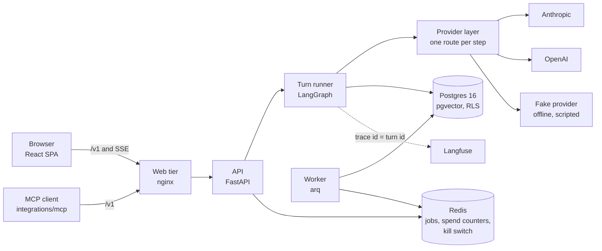
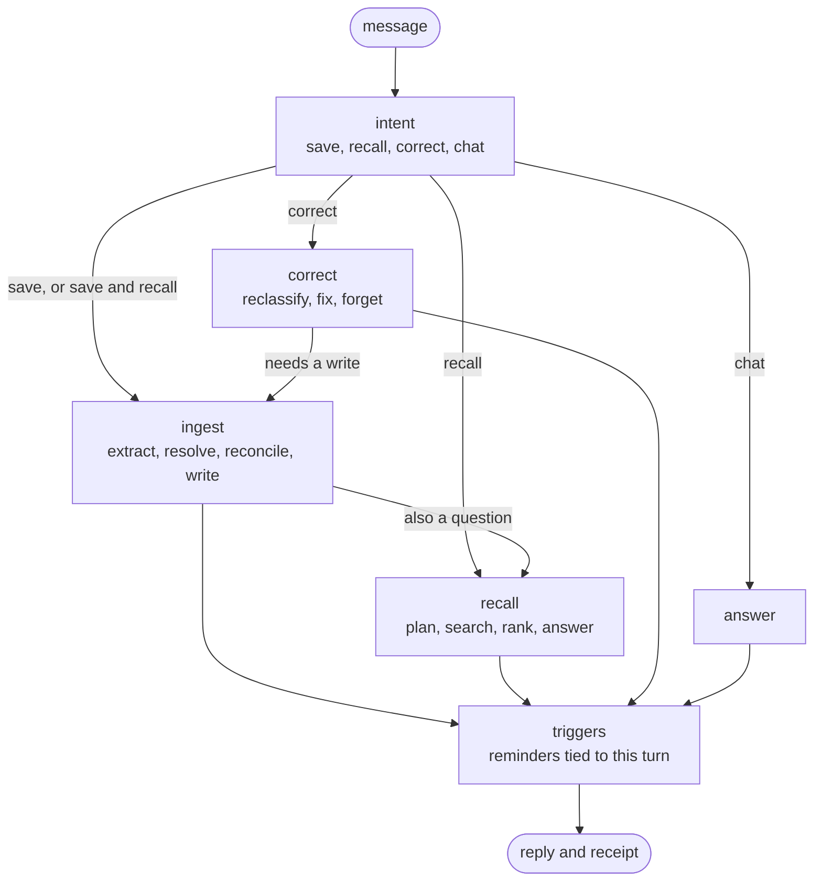
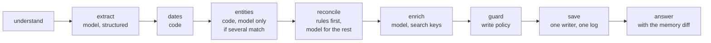
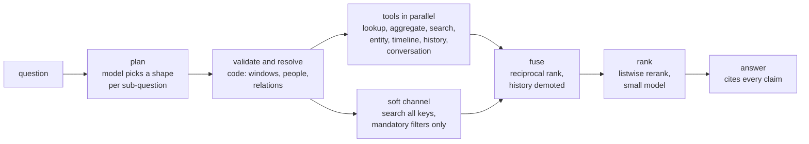
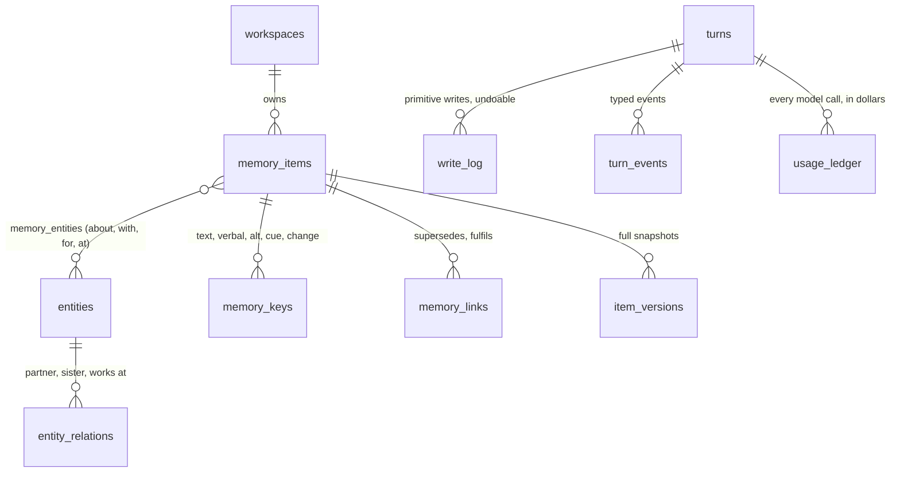

# Architecture

How 2nd Mind is put together, in the order you would want to read it. Each section ends with
where the code is and which [decision record](adr/README.md) explains the choice. The product
spec is [`PRD.md`](PRD.md); this page is the shape of what was built from it.

1. [The system](#the-system) · 2. [One turn](#one-turn) · 3. [Saving](#saving-catch-it) ·
4. [Recalling](#recalling-find-it) · 5. [The memory model](#the-memory-model) ·
6. [Showing the work](#showing-the-work-prove-it) · 7. [Where trust is enforced](#where-trust-is-enforced) ·
8. [How the code is organised](#how-the-code-is-organised) · 9. [How it is tested and measured](#how-it-is-tested-and-measured)

## The system

A React single-page app talks to one origin. nginx serves the static site and proxies `/v1` to
the API, so there is no CORS and the browser sees one host. A turn runs a small LangGraph graph;
every model call leaves through one provider layer; everything the agent remembers lives in one
Postgres database with row-level security.

- **One store.** Relational rows, vectors and full-text search are all Postgres, so isolation,
  transactions and backups are one thing to reason about
  ([ADR-0002](adr/0002-postgres-single-store.md), [ADR-0024](adr/0024-vector-storage.md)).
- **A thin graph, fat modules.** LangGraph only routes; the logic is plain modules that can be
  tested without it ([ADR-0005](adr/0005-langgraph-thin-graph.md)).
- **Models are configuration.** Each step (intent, extract, plan, rerank, answer, …) names its
  provider and model in [`config/models.yaml`](../backend/config/models.yaml), with a fallback.
  Nothing else knows which provider served a call ([ADR-0006](adr/0006-provider-layer.md),
  [ADR-0013](adr/0013-config-routing-and-hash.md)). With no keys the whole app runs on the fake
  provider, which is what `make up` and CI use.
- **Background work** runs in the worker: expiring the quick layer, embedding keys that were saved
  while a provider was down, expiring guests, and reconciling the spend counters from the ledger
  ([ADR-0007](adr/0007-redis-arq.md)).

## One turn

Every message, whatever it is, goes through the same graph
([`agent/graph.py`](../backend/src/secondmind/agent/graph.py)). The first node decides what the
message is; code routes on that decision.

A turn is a sequence of **typed events** (steps, model calls, tool calls, the memory diff, usage)
stored as it happens and streamed over SSE with a heartbeat. The same events feed the chat, the
Trail and the inspector, so what you see live is what you can open later
([ADR-0015](adr/0015-turn-events-and-streaming.md), [ADR-0029](adr/0029-agent-steps-on-the-stream.md)).

## Saving (catch it)

A save is not "embed and store". It is a pipeline whose every step is a visible decision.

- **Extraction is a model call; everything it names is checked by code.** Time expressions are
  copied verbatim and resolved by a deterministic grammar ("last night", "next May", recurring
  routines as RRULEs), never by the model ([ADR-0022](adr/0022-time-resolution.md)). People and
  places are matched against what already exists before anything new is made.
- **Reconciliation, not de-duplication.** A new fact is compared with what is already known and
  becomes one of `new`, `add_detail`, `supersede`, `fulfil`, `link` or `no_op`. "I moved to Pune"
  supersedes "I live in Bengaluru": the old row gets a `valid_to` and a link, it is not
  overwritten, and the answer to "where did I live in March?" still works. The rules that settle
  most cases are in code; the model only sees what they leave open
  ([ADR-0019](adr/0019-reconciliation.md)).
- **Every write passes a policy.** A rule table decides `allowed`, `held for you` or `blocked`
  for each change. Secrets are refused rather than stored, hypotheticals are kept out of facts,
  a core write that came from pasted content is held for you, and content can never change a rule,
  set a trigger or edit another memory ([ADR-0021](adr/0021-sensitivity-and-secrets.md),
  [ADR-0037](adr/0037-content-is-data.md)).
- **One writer, one log, undo for free.** All changes go through `MemoryWriter`, which records
  primitive write-log rows with before and after snapshots and a full version of each item.
  Undoing a turn replays the log backwards as a new turn ([ADR-0018](adr/0018-memory-model.md)).
- **Findability is built at write time.** Each memory gets several search keys, including a
  sentence rendered by a pure function in first person with absolute dates, so "last Sunday"
  and "27 September" meet. Embeddings are cached by content hash
  ([ADR-0020](adr/0020-retrieval-keys.md), [ADR-0023](adr/0023-extract-and-enrich.md)).

## Recalling (find it)

A question is planned by a model and executed by code.

- **The model picks the shape; code does the rest.** The planner returns one of 13 query shapes
  per sub-question (exact, list, latest, history, time window, order, count, set, entity,
  semantic, why, situational, conversation), and a table in code maps each shape to its tools.
  Time expressions must appear verbatim in the message or the plan is rejected and retried;
  anything it names that the system can't resolve is dropped and shown, never guessed
  ([ADR-0025](adr/0025-query-planning.md)).
- **No filter is ever the only way in.** The soft channel searches every key with only the
  mandatory filters, in parallel with the structured tools, so a mis-planned filter degrades the
  answer instead of emptying it. Lexical (`ts_rank_cd`) and dense (pgvector) results are fused
  by reciprocal rank, and rows that are no longer current are demoted except for questions about
  history ([ADR-0026](adr/0026-hybrid-search.md)).
- **Answers cite their sources, and say when there are none.** Each claim carries a citation that
  opens the memory behind it. With no evidence the reply comes from a template and no model is called.

## The memory model

Ten **kinds** (fact, preference, episode, plan, task, intention, resource, note, rule, pattern),
each with its own lifecycle of **states** enforced by a database constraint. People, places,
organisations, works and topics are **entities** with relations. Time has **three clocks**, because
"when I said it", "when it happened" and "when it was true" are different questions.

Search lives only in `memory_keys` (text, a rendered sentence, alternative phrasings, cue
situations, an embedding and a generated `tsvector`). Items carry no search columns, so a
memory can be re-indexed without touching it. A partial index on "current value" makes
"what is true now" a single lookup. Every workspace-owned table carries `workspace_id` and a
row-level-security policy ([ADR-0018](adr/0018-memory-model.md),
[ADR-0003](adr/0003-workspace-isolation-rls.md)).

## Showing the work (prove it)

The product's line is that it shows its work, and the architecture makes that cheap rather than
bolted on.

- **The glass box.** Each turn's decisions, memory diff, retrieval candidates, tool calls, timing
  and cost are stored as events and rendered by the inspector, with the **Trail** inline in the
  chat. Every step the backend can emit has one entry in the UI's step catalogue, and the type
  check fails if one is missing ([ADR-0028](adr/0028-ink-design-system.md)).
- **Every number on the front page comes from a recorded run** of a committed evaluation set,
  stamped with the commit and the models. CI fails if the page's numbers drift from the run
  files (`make headline-check`). See [How it is tested and measured](#how-it-is-tested-and-measured).
- **Every call is traced and priced.** The trace id is the turn id ([ADR-0008](adr/0008-langfuse-tracing.md));
  each model call is written to a dollar ledger that quotas, caps and the cost shown under each
  answer all read.

## Where trust is enforced

| Concern | How it is held | Proven by |
|---|---|---|
| One person's data never reaches another | Repositories need a `WorkspaceScope` to exist; Postgres RLS is the backstop on every owned table; the app role is not the owner and cannot bypass RLS | Per-table isolation tests through repositories and raw SQL; a catalog test fails if a table with `workspace_id` has no policy; readiness fails if the role could bypass RLS ([ADR-0003](adr/0003-workspace-isolation-rls.md)) |
| Secrets are not kept | The write policy refuses them, and so do the fields a link's digest may fill | Policy and ingestion golden cases ([ADR-0021](adr/0021-sensitivity-and-secrets.md)) |
| A pasted link cannot steer the agent | Content is data: it reaches a model only inside a delimited block, with a closed output schema and a policy that holds anything that would change a rule or another item | Injection eval cases and end-to-end tests of the link path ([ADR-0037](adr/0037-content-is-data.md)) |
| A link cannot reach inside the network | One fetch door; the address is resolved once, every result checked, and the connection goes to the checked address; each redirect is re-checked | Unit tests of the rules and integration tests against real servers ([ADR-0036](adr/0036-link-fetching-and-fetch-safety.md)) |
| Spend cannot run away | A gate before every turn: kill switch, daily and monthly caps, provider credit, then the person's dollar quota. It fails closed | Spend-safety tests and an e2e spec that pauses the app ([ADR-0032](adr/0032-spend-safety.md)) |
| The web tier is hardened | Strict CSP, no CORS, cross-site writes refused, JSON-only writes, request size limits, compression on static files only | `test_web_hardening.py`, `test_web_delivery.py`, `security.spec.ts`, `delivery.spec.ts` ([ADR-0034](adr/0034-web-hardening-and-staging-access.md), [ADR-0045](adr/0045-delivery-and-link-previews.md)) |
| Prompts do not change under a measurement | Prompts are versioned files; a released version is never edited, a change is `v<N+1>`, and a lock file pins them | `test_prompts.py` ([ADR-0014](adr/0014-prompt-registry.md)) |
| Config is checked at start-up | Environment only, validated; routing, prices and a config hash are stamped on runs | Config matrix tests ([ADR-0013](adr/0013-config-routing-and-hash.md)) |

Message content is never logged (a development flag is the only exception), and fixtures, seeds
and the sample persona are synthetic.

## How the code is organised

One top-level module per domain under [`backend/src/secondmind/`](../backend/src/secondmind/).
Modules talk through their `__init__` (or `adapters` from composition roots) and nothing deeper.
Six import-linter contracts enforce it in CI ([ADR-0011](adr/0011-import-boundaries.md)).

| Module | Owns |
|---|---|
| `core` | Shared types only: ids, scopes, usage, events, errors. No I/O, no imports from other modules |
| `api` | FastAPI routes, schemas, SSE and the composition root. The only module that imports FastAPI |
| `agent` | The turn graph, the turn runner, event storage ports |
| `ingestion` | Extract, resolve time and entities, reconcile, enrich |
| `retrieval` | Query planning, hybrid search, fusion, rerank, citations |
| `corrections` | Reclassify, correct a mistake, forget; edits from the glass box |
| `memory` | The store and the writer that is the only way to change it |
| `policy` | The write-policy rule table |
| `providers` | The provider interface, per-step router, resilience, adapters and the fake |
| `metering` | The usage ledger, dollar quotas by tier, the spend gate |
| `links` | Reading a page a person pasted, through the one fetch door |
| `persona`, `auth` | The sample persona and its per-visitor copy; identity, guests and sessions |
| `jobs`, `observability`, `config` | The worker and its schedule; logs, request context and the tracing port; env settings, routing, prices, prompts |
| `evals` | The evaluation harness, eval sets and stamped runs |

SDKs (`sqlalchemy`, `anthropic`, `openai`, `redis`, `arq`, `langfuse`) are imported only in
`*/adapters/`, so swapping one is a change in one place.

## How it is tested and measured

- **Unit and integration.** Over 700 test functions: 69 unit test files that need no services, and
  25 integration files that run against real Postgres and Redis in containers (isolation, migrations
  as a non-superuser owner, worker shutdown and re-queue, link fetching against real servers).
- **End to end.** 19 Playwright specs against the whole stack in fake-provider mode, at desktop,
  1440 px, 360 px and under reduced motion, with axe accessibility checks on the landing page, the
  evidence page and the sample.
- **Evaluation sets.** Cases for intent, ingestion, recall, links, injection and the sample persona
  run against the fake provider in CI and against live models on demand. Live runs are stamped with
  the commit and the models and committed as run files; a live run refuses uncommitted code. The
  numbers shown on the front page are read from those files.
- **Static gates.** `mypy --strict`, ruff, import contracts, an OpenAPI snapshot that the generated
  TypeScript client must match, a design-system check (tokens only, contrast, bundle budget),
  commit-message rules, gitleaks over the full history, dependency audits and an image scan.

`make check` runs everything CI runs except the end-to-end suite.

## Where to go next

- Why a choice was made: [`docs/adr/`](adr/README.md), one page each.
- What it must do: [`PRD.md`](PRD.md).
- How it looks and why: [`design/system.md`](design/system.md).
- How it is run: [`runbook.md`](runbook.md).
